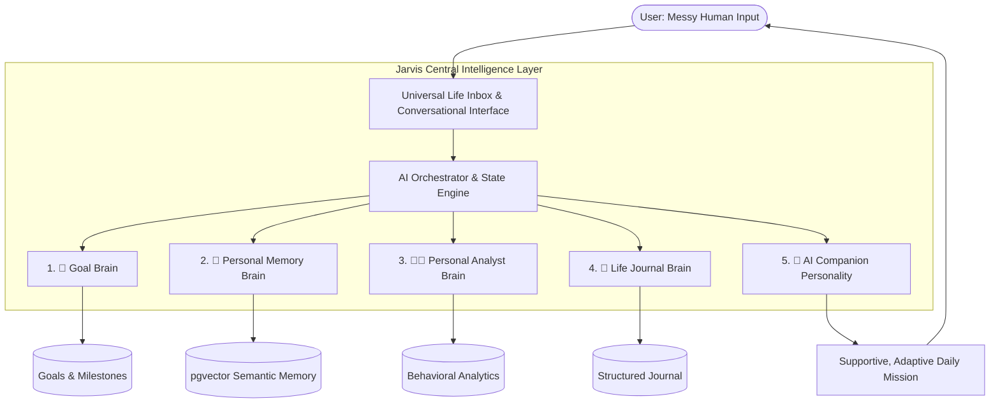
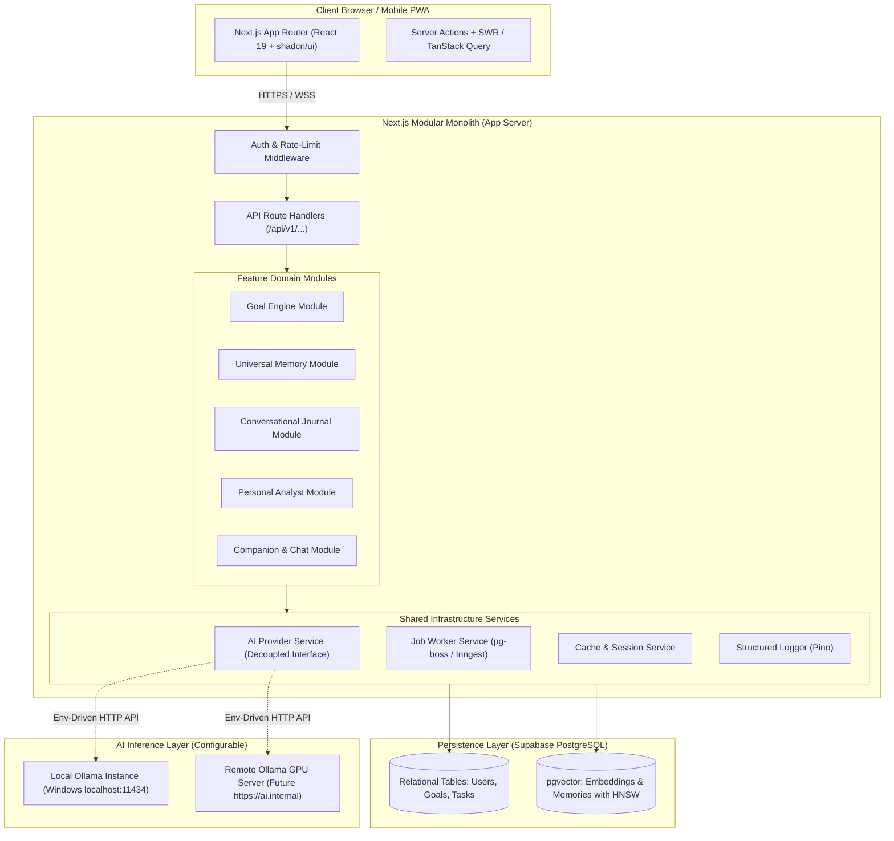
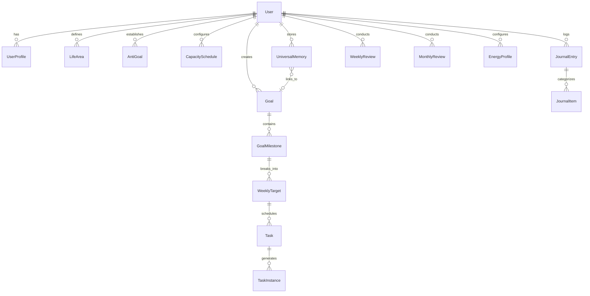
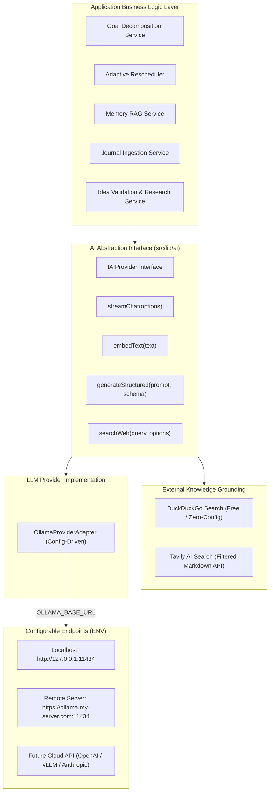
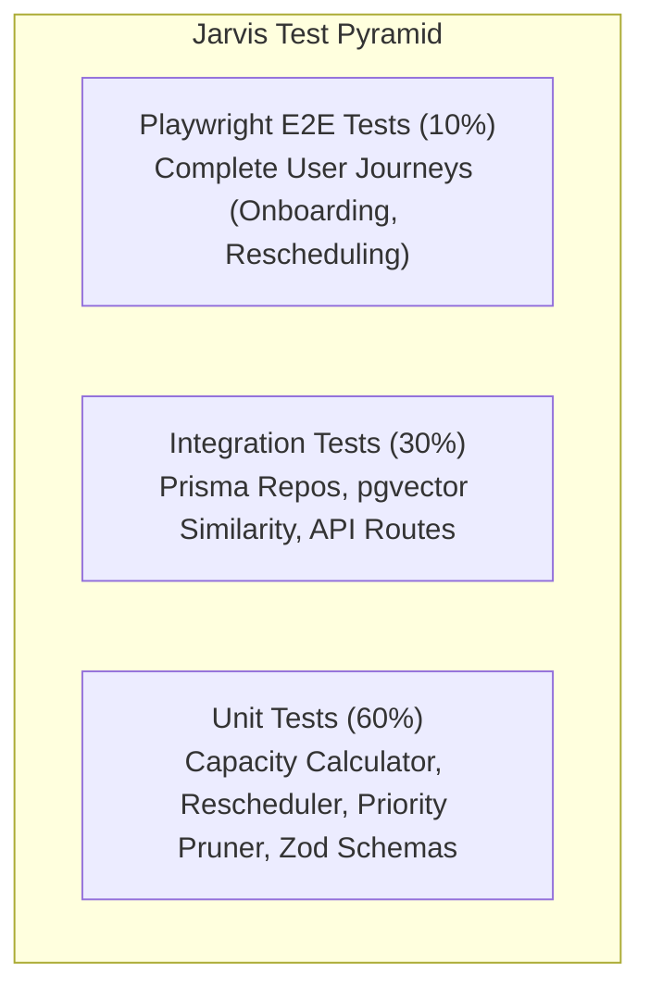
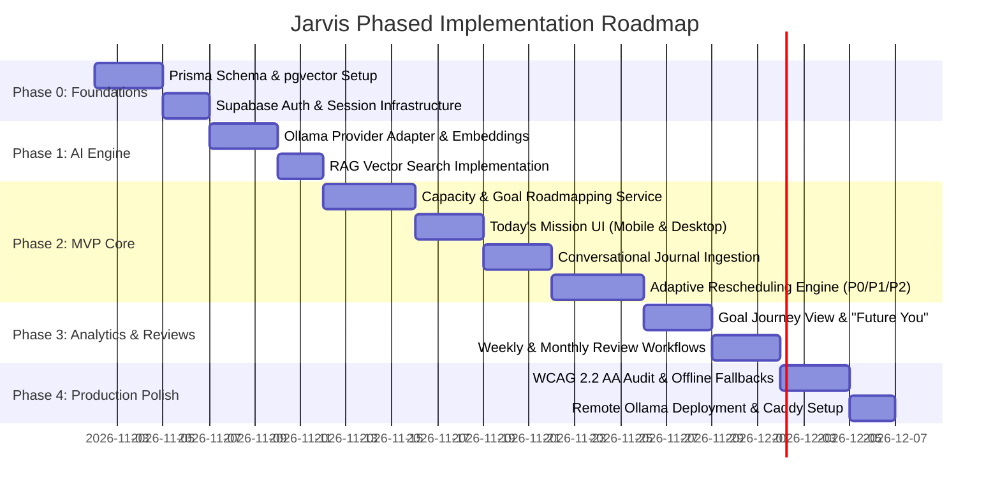

# Jarvis: The AI Goal Traveler & Personal Life Operating System
## Master Project Planning Document & Architectural Specification

**Product Name**: Jarvis (The AI Goal Traveler)  
**Role**: Senior Enterprise Architect & Lead Full-Stack Engineer  
**Governance**: Governed by Globally Installed ECC Skills (`backend-patterns`, `postgres-patterns`, `api-design`, `error-handling`, `security-review`, `cost-aware-llm-pipeline`, `react-patterns`, `react-performance`, `accessibility`, `frontend-a11y`, `tdd-workflow`, `e2e-testing`)  
**Status**: Formal Planning & Architecture Baseline (Zero Application Source Code Implemented)

---

## 1. Project Overview

**Jarvis** is not a conventional todo list or standard chatbot wrapper. It is a **Personal Goal Operating System and Long-Term Life Companion** designed to accompany a person on their multi-year journey from who they are today to who they aspire to become.

Traditional productivity applications suffer from a fundamental failure mode: they are rigid, unforgiving task checklists that generate shame and stress when life inevitably disrupts planned schedules. Users miss tasks, accumulate backlog debt, experience guilt, and abandon the application.

Jarvis inverts this paradigm through five core product pillars:
1. **Goals are Persistent; Tasks are Flexible**: Schedules adapt to the human rather than forcing the human to conform to a brittle calendar.
2. **Messy Human Input to Structured Memory**: The user talks or types naturally; the AI classifies, extracts, and organizes knowledge, habits, learnings, and reflections into a persistent relational and vector memory store.
3. **Deep Motivation Triggers**: Tasks are never disconnected checklist items; they are hierarchically anchored to the user's emotional "Why" (e.g., identity, pride, confidence, family, financial freedom).
4. **Realistic Capacity & Energy Modeling**: The system calculates realistic available time (accounting for sleep, commute, day job, and family commitments) and schedules deep work according to personal energy peaks.
5. **Adaptive Rescheduling with P0/P1/P2 Pruning**: When life happens, Jarvis dynamically reprioritizes the roadmap, pushes critical milestones forward, and prunes or merges optional tasks to prevent psychological overload.

---

## 2. Understanding of the Original Idea & The 5 Major Brains



### The 5 Architectural Brains

1. **🎯 Goal Brain (Hierarchical Decomposition Engine)**:
   * Translates abstract visions into actionable reality:
     $$\text{Dream} \rightarrow \text{Long-Term Vision} \rightarrow \text{Yearly Objective} \rightarrow \text{3–4 Month Goal} \rightarrow \text{Milestones} \rightarrow \text{Weekly Targets} \rightarrow \text{Daily Tasks} \rightarrow \text{Action}$$
   * Maintains task priority levels: **P0 (Critical — Must happen)**, **P1 (Important — Should happen)**, and **P2 (Optional — Nice to have)**.
   * Embeds deep emotional anchors (*What? Why? Why now? What happens if I don't? Success definition*).

2. **🧠 Personal Memory Brain (Universal Memory Model)**:
   * Replaces fragmented tables with an integrated memory graph classified by type: `Goal`, `Learning`, `Experience`, `Idea`, `Decision`, `Habit`, `Achievement`, `Failure`, `Preference`, and `Reflection`.
   * Combines relational metadata with vector embeddings in PostgreSQL via `pgvector` to enable multi-year semantic recall (e.g., *"What did I learn about Redis 8 months ago?"*).
   * Distinguishes temporary conversational chatter from long-term identity memories. Provides user-controlled memory governance (*view, edit, delete, mark private, forget topic*).

3. **🧑‍💼 Personal Analyst (Behavioral Pattern Engine)**:
   * Detects friction, avoidance, and consistency patterns beyond raw numbers:
     $$\text{Observation} \rightarrow \text{Explanation} \rightarrow \text{Suggestion} \rightarrow \text{Action}$$
   * Models realistic weekly capacity (e.g., subtracting fixed work, commute, and family obligations to find true available hours).
   * Identifies life area imbalances (e.g., 90% career effort vs. 0% health).

4. **📔 Life Journal (Frictionless Natural Language Ingestion)**:
   * Accepts stream-of-consciousness natural text or voice.
   * Automatically parses entries into structured buckets: `Work Accomplishments`, `Learnings`, `Health & Fitness`, `Habits`, and `Reflections`.

5. **🤝 AI Companion (The Ethical Personality Layer)**:
   * Adheres to strict ethical boundaries: *Support, don't control; Challenge, don't shame; Encourage progress over perfection; Protect user wellbeing; Never emotionally manipulate*.
   * Speaks in the user's chosen motivational dialect without generic platitudes.

---

## 3. Functional Requirements (FR)

### Module 1: Onboarding & Personal Context Profiling
* **FR-1.1**: The system shall collect user baseline data: timezone, typical work schedule, fixed weekly commitments, energy peak windows (morning, afternoon, night), and core life areas.
* **FR-1.2**: The system shall calculate the user's **Realistic Weekly Capacity** (total hours minus sleep, day job, commute, and family commitments).
* **FR-1.3**: The system shall allow the user to select their preferred motivational language and identity models (e.g., Future Self, Family, Health, Financial Independence, Personal Mastery).
* **FR-1.4**: The system shall capture **Anti-Goals** (what the user strictly does *not* want their life to become).

### Module 2: Goal Engine & Hierarchical Roadmapping
* **FR-2.1**: The system shall enforce the 7-level hierarchy: Dream $\rightarrow$ Vision $\rightarrow$ Yearly Objective $\rightarrow$ Quarterly Goal $\rightarrow$ Milestones $\rightarrow$ Weekly Targets $\rightarrow$ Daily Tasks.
* **FR-2.2**: Every created goal must capture: *What*, *Why*, *Why Now*, *Risk of Inaction*, *Success Metric*, and *Target Date*.
* **FR-2.3**: The AI shall evaluate goal scope against the user's remaining weekly capacity and flag impossible time allocations before finalizing the roadmap.
* **FR-2.4**: The system shall assign an explicit priority tag (`P0_CRITICAL`, `P1_IMPORTANT`, `P2_OPTIONAL`) to every generated task.

### Module 3: Daily Mission & Adaptive Scheduling
* **FR-3.1**: The system shall render a minimalist "Today's Mission" screen highlighting: The Main Mission, The Reason ("Why"), 3–5 Prioritized Tasks, and Current Journey Progress.
* **FR-3.2**: When a task is marked missed or incomplete, the adaptive scheduling engine shall:
  * Reschedule `P0` tasks to the next realistic energy block.
  * Reschedule or merge `P1` tasks while checking capacity limits.
  * Drop or postpone `P2` tasks to prevent snowballing backlogs.
* **FR-3.3**: The AI shall generate a humanized notification explaining schedule adjustments without guilt or punitive messaging.

### Module 4: Conversational Journal & Universal Life Inbox
* **FR-4.1**: The system shall provide a single conversational entry point ("Life Inbox" / "Talk to Jarvis") capable of receiving raw unstructured text.
* **FR-4.2**: The AI shall classify incoming text into categorized entities: `Task`, `Business Idea`, `Technical Learning`, `Journal Entry`, `Decision`, or `Reflection`.
* **FR-4.3**: Structured entities shall be automatically linked to corresponding goals or archived in the user's knowledge vault.

### Module 5: Universal Memory & Semantic Retrieval (RAG)
* **FR-5.1**: The system shall generate dense vector embeddings for all classified memories using an isolated, configurable embedding model.
* **FR-5.2**: The system shall perform hybrid search (vector cosine similarity via `pgvector` + metadata filtering by user, life area, and memory type).
* **FR-5.3**: The system shall provide a "My Memory" management interface allowing the user to view, edit, delete, or mark memories as private.

### Module 6: Personal Life Analyst & Journey Forecasting
* **FR-6.1**: The system shall generate a visual "Goal Journey" view showing current milestone position, percentage complete, and dynamic estimated achievement dates.
* **FR-6.2**: The system shall provide a "Future You" projection modeling three trajectories: *Current Consistency*, *Slight Improvement (+2 sessions/wk)*, and *Stalled Trajectory*.
* **FR-6.3**: The system shall detect behavioral patterns across rolling 14-day windows (e.g., correlation between late work hours and missed gym workouts).

### Module 7: Periodic Tactical & Strategic Reviews
* **FR-7.1**: The system shall initiate an interactive **Weekly Tactical Review** comparing planned targets vs. actuals, identifying blockers, and revising next week's capacity.
* **FR-7.2**: The system shall compile a **Monthly Strategic Review** summarizing achievements, accumulated learnings, life area balance distribution, and personal identity shifts.

---

## 4. Non-Functional Requirements (NFR)

* **NFR-1 (Performance & Latency)**:
  * Web application First Contentful Paint (FCP) $< 1.2\text{s}$ on desktop, $< 2.0\text{s}$ on mobile 4G.
  * Server-side route handler latency $< 150\text{ms}$ for non-AI database operations.
  * AI chat token streaming must start yielding first tokens within $800\text{ms}$ on local Ollama (7B Q4_K_M on modern CPU/GPU) and $< 400\text{ms}$ on remote GPU servers.
* **NFR-2 (Scalability & Architecture)**:
  * Clean modular monolith structure with strict boundary encapsulation between domain modules.
  * Database access pooling managed via Supabase PgBouncer with maximum connection limits.
  * pgvector queries optimized with HNSW indexes for sub-50ms vector searches up to 100,000 memories per user.
* **NFR-3 (Reliability & Offline AI Resilience)**:
  * Application must remain 100% functional for viewing tasks, goals, and history even if the local or remote Ollama instance is temporarily unreachable.
  * AI inference failures must degrade gracefully to queued background tasks or clear client-side status banners.
* **NFR-4 (Security & Data Sovereignty)**:
  * Zero external third-party data leakage: AI inference runs entirely on the user's controlled Ollama instance.
  * Multi-layer input validation via Zod schemas at all API boundaries.
  * PostgreSQL Row Level Security (RLS) policies guaranteeing strict tenant isolation.
* **NFR-5 (Accessibility & Ergonomics)**:
  * Full compliance with **WCAG 2.2 Level AA** standards (minimum 4.5:1 text contrast, 44x44px mobile touch targets, semantic ARIA landmarks, visible focus rings, and screen-reader navigable accordions/drawers).
* **NFR-6 (Maintainability & Code Quality)**:
  * Strict TypeScript mode (`noImplicitAny: true`, `strictNullChecks: true`).
  * 100% typed database operations via Prisma ORM client extensions.

---

## 5. Complete Technology Stack

```
┌────────────────────────────────────────────────────────────────────────┐
│                        COMPLETE TECHNOLOGY STACK                       │
├────────────────────────────────────────────────────────────────────────┤
│  Frontend Layer:                                                       │
│    • Framework: Next.js 15+ (App Router, Server Components & Actions)  │
│    • UI Library: React 19, Tailwind CSS v4, shadcn/ui                  │
│    • Primitives: Radix UI, Lucide React Icons                          │
│    • Animation & Sound: Framer Motion + Micro-Audio cues (`use-sound`) │
│    • Voice Input: Native Web Speech API (0 RAM, hands-free journaling) │
│    • Experience: Progressive Web App (PWA) + Web Notifications API     │
│                                                                        │
│  Backend & API Layer:                                                  │
│    • Runtime: Node.js 22 LTS / Next.js Route Handlers                  │
│    • Architecture: Modular Monolith (Domain/Service/Repo Layers)       │
│    • Validation: Zod v3 schemas for all inputs, outputs & env vars     │
│    • Streaming: Server-Sent Events (SSE) via Web Streams API           │
│                                                                        │
│  Database & Persistence Layer:                                         │
│    • Database: Supabase PostgreSQL (Postgres 16+)                      │
│    • ORM: Prisma ORM v6+ with pgvector client extensions               │
│    • Extensions: pgvector (vector similarity), uuid-ossp               │
│    • Connection Pooling: PgBouncer transaction pooling                 │
│                                                                        │
│  AI Engine (Decoupled & Provider-Independent):                         │
│    • Inference Server: Ollama (Local Windows initially, Remote later) │
│    • Chat/Reasoning Model: qwen3:4b (Primary) / qwen2.5:7b / llama3.2 │
│    • Embedding Model: nomic-embed-text (768d) / mxbai-embed-large      │
│    • AI SDK: Vercel AI SDK Core (`ai`) + Custom Ollama Provider Wrapper│
│    • Web Search Tool: DuckDuckGo (Free/Zero-Config) or Tavily Search API│
└────────────────────────────────────────────────────────────────────────┘
```

---

## 6. Additional Recommended Technologies & Justifications

To make the architecture complete, reliable, and enterprise-ready, the following supplementary technologies are specified based on rigorous project requirements:

| Technology / Library | Purpose in Jarvis | Justification & Requirement Link | Necessity | Cost / Infra Impact |
|---|---|---|---|---|
| **Supabase Auth** (`@supabase/ssr`) | User authentication & session management | Enforces tenant boundaries, secure cookie exchange, and native integration with PostgreSQL Row Level Security (RLS). | **Mandatory** | Free tier covers 50k MAU. |
| **Inngest** or **pg-boss** | Background jobs & workflow orchestration | Handles async vector embedding generation, weekly review triggers, and 14-day pattern analysis without blocking HTTP handlers. | **Mandatory** | `pg-boss` runs inside existing Postgres (zero cost). |
| **Upstash Redis** (`@upstash/redis` + `@upstash/ratelimit`) | Sliding-window rate limiting & response caching | Protects Next.js endpoints and local Ollama inference from request flooding; caches static roadmap structures. | **Recommended** | Free tier (10,000 commands/day). |
| **Pino** + **Pino-Pretty** | Structured JSON logging | High-speed, low-overhead logging for API routes, AI prompt latency, and database query profiling. | **Mandatory** | Open source, zero cost. |
| **Vitest** + **Testing Library** | Unit & service integration tests | Fast test runner with native ESM/TypeScript support to test rescheduling algorithms and capacity calculations. | **Mandatory** | Open source, zero cost. |
| **Playwright** | End-to-end browser testing | Verifies multi-step user journeys (onboarding $\rightarrow$ goal breakdown $\rightarrow$ daily task completion) across mobile/desktop. | **Recommended** | Open source, runs locally and in CI. |
| **Docker & Docker Compose** | Containerized deployment | Packages Next.js, Ollama, and test Postgres into identical local and remote server environments. | **Mandatory** | Standard devops tooling. |
| **Caddy Server** | Reverse proxy & automatic HTTPS | Acts as the TLS termination gateway when Ollama is moved to a remote server. Handles SSL certificate renewal automatically. | **Mandatory (Phase 2)** | Lightweight, zero-config TLS. |
| **Zod Environment Validator** (`@t3-oss/env-nextjs`) | Type-safe environment validation | Fails builds immediately if `OLLAMA_BASE_URL` or database connection strings are missing or malformed. | **Mandatory** | Open source, zero cost. |
| **DuckDuckGo / Tavily Search** (`duck-duck-scrape` / `@tavily/core`) | On-demand external web search tool | Grounding tool when Jarvis encounters unknown topics, validates business ideas, or creates current tech roadmaps. | **Recommended** | DuckDuckGo is 100% free; Tavily offers 1,000 free searches/mo. |
| **Web Speech API** (`webkitSpeechRecognition`) | Native browser voice-to-text dictation | Enables hands-free natural conversational journaling without running a heavy local Whisper model. | **Recommended** | Built into modern browsers, 0 RAM overhead, 100% free. |
| **PWA & Web Notifications** (`@serwist/next` / Web Notifications) | Native desktop/mobile app installation & check-in prompts | Transforms web app into a standalone desktop & mobile home-screen app; triggers morning briefing and evening reflections. | **Recommended** | Open source, 100% free. |
| **PostgreSQL Hybrid Search** (`tsvector` + `pgvector`) | Keyword + Semantic Vector Search fusion | Prevents semantic search from missing exact code keywords, dates, or titles by fusing BM25 text rank with vector cosine distance. | **Mandatory** | Built into Supabase Postgres, 0 extra infrastructure. |

---

## 7. System Architecture

The following diagram illustrates the complete end-to-end system topology across the Client, Application Server, Data Layer, and AI Inference Engine:



---

## 8. Application Architecture & Modular Monolith Pattern

In accordance with ECC `backend-patterns` and `react-patterns`, the application enforces a strict **Modular Monolith Architecture** with 4 distinct internal layers:

```mermaid
flowchart LR
    subgraph Presentation["1. Presentation Layer"]
        Page[App Router Pages & Layouts]
        Comp[UI Components & Forms]
        SSE[Streaming Chat Listeners]
    end

    subgraph Application["2. Application & Controller Layer"]
        Handlers[Route Handlers /api/v1/*]
        Actions[Server Actions]
        DTOs[Zod DTO Validation Schemas]
    end

    subgraph Domain["3. Domain Business Logic Layer"]
        GoalDomain[Goal Roadmapping & Pacing Logic]
        CapacityDomain[Capacity & Energy Budget Calculator]
        RescheduleDomain[Adaptive Rescheduling & P0/P1/P2 Engine]
        MemoryDomain[Memory Classification & Semantic Search]
        AnalystDomain[Behavioral Pattern Detection Engine]
    end

    subgraph Infrastructure["4. Infrastructure & Data Layer"]
        PrismaRepo[Prisma Repositories with pgvector]
        AIAdapter[Ollama / AI Provider Client Adapter]
        QueueAdapter[Background Job Worker Adapter]
    end

    Presentation --> Application
    Application --> Domain
    Domain --> Infrastructure
```



### Module Boundary Invariants
1. **Zero Cross-Module Direct Database Access**: The `JournalModule` must never directly query `Goal` tables; it must interface via the exported `GoalService`.
2. **Framework-Free Domain Logic**: Pure calculation algorithms (such as the Capacity Budget Calculator and Adaptive Reschedule Algorithm) reside in pure TypeScript functions with zero dependencies on Next.js or Prisma, making them 100% testable via unit tests.
3. **Repository Pattern for Persistence**: Database queries are encapsulated within explicit Repository classes implementing domain interfaces, facilitating mock testing and database migration.

---

## 9. Database Design & Prisma Schema Planning

The database utilizes **PostgreSQL 16+** hosted on Supabase, leveraging standard B-tree indexes, composite indexes, and the `pgvector` extension for cosine distance vector search.



### Database Tables Specification

```prisma
datasource db {
  provider   = "postgresql"
  url        = env("DATABASE_URL")
  directUrl  = env("DIRECT_URL")
  extensions = [pgvector(map: "vector"), uuidOssp(map: "uuid-ossp")]
}

generator client {
  provider        = "prisma-client-js"
  previewFeatures = ["postgresqlExtensions"]
}

enum PriorityLevel {
  P0_CRITICAL
  P1_IMPORTANT
  P2_OPTIONAL
}

enum TaskStatus {
  PENDING
  IN_PROGRESS
  COMPLETED
  MISSED
  RESCHEDULED
  PRUNED
}

enum MemoryType {
  GOAL
  LEARNING
  EXPERIENCE
  IDEA
  DECISION
  HABIT
  ACHIEVEMENT
  FAILURE
  PREFERENCE
  REFLECTION
}

enum EnergyLevel {
  HIGH_FOCUS
  MEDIUM
  LOW_RECOVERY
}

enum MemoryDurability {
  TEMPORARY        // Conversational context, auto-expires after 7 days
  SHORT_TERM       // Useful but not identity-defining, reviewed monthly
  LONG_TERM        // Important learnings, decisions, preferences
  PERMANENT        // User explicitly said "remember this" or core identity
}

enum UserIntent {
  GOAL_CREATE       // User wants to set, update, or evolve a goal
  JOURNAL_ENTRY     // User is logging what happened (daily reflection)
  MEMORY_QUERY      // User is asking about something they previously shared
  IDEA_CAPTURE      // Random thought, idea, learning, or observation to save
  SCHEDULE_QUERY    // Asking about tasks, schedule, or today's plan
  RESCHEDULING      // Missed something or wants to adjust schedule
  GENERAL_CHAT      // Casual conversation, emotional support, or unclear
}

model User {
  id                String             @id @default(cuid())
  email             String             @unique
  createdAt         DateTime           @default(now())
  updatedAt         DateTime           @updatedAt
  profile           UserProfile?
  lifeAreas         LifeArea[]
  antiGoals         AntiGoal[]
  capacitySchedule  CapacitySchedule?
  energyProfile     EnergyProfile?
  goals             Goal[]
  memories          UniversalMemory[]
  journalEntries    JournalEntry[]
  weeklyReviews     WeeklyReview[]
  monthlyReviews    MonthlyReview[]
  chatSessions      ChatSession[]

  @@map("users")
}

model UserProfile {
  id                  String   @id @default(cuid())
  userId              String   @unique
  fullName            String
  timezone            String   @default("UTC")
  motivationalStyle   String   @default("supportive_friend") // future_self, family, stoic, ambitious
  preferredWorkDays   Int[]    @default([1, 2, 3, 4, 5])
  createdAt           DateTime @default(now())
  updatedAt           DateTime @updatedAt
  user                User     @relation(fields: [userId], references: [id], onDelete: Cascade)

  @@map("user_profiles")
}

model CapacitySchedule {
  id                  String   @id @default(cuid())
  userId              String   @unique
  dayJobHoursWeekly   Float    @default(40.0)
  sleepHoursDaily     Float    @default(7.5)
  commuteHoursDaily   Float    @default(1.0)
  fixedCommitmentsWeekly Float @default(10.0)
  netAvailableGoalHours Float  // Computed: 168 - (sleep*7 + work + commute*5 + fixed)
  peakEnergyWindow    EnergyLevel @default(HIGH_FOCUS) // Legacy shortcut; see EnergyProfile for granular slots
  createdAt           DateTime @default(now())
  updatedAt           DateTime @updatedAt
  user                User     @relation(fields: [userId], references: [id], onDelete: Cascade)

  @@map("capacity_schedules")
}

model EnergyProfile {
  id              String      @id @default(cuid())
  userId          String      @unique
  morningEnergy   EnergyLevel @default(HIGH_FOCUS)   // 6am - 12pm (deep work focus)
  afternoonEnergy EnergyLevel @default(MEDIUM)       // 12pm - 6pm (meetings, routine tasks)
  eveningEnergy   EnergyLevel @default(MEDIUM)       // 6pm - 9pm (creative / secondary goals)
  nightEnergy     EnergyLevel @default(LOW_RECOVERY) // 9pm - 12am (reading, unwinding, low-cognitive load)
  createdAt       DateTime    @default(now())
  updatedAt       DateTime    @updatedAt
  user            User        @relation(fields: [userId], references: [id], onDelete: Cascade)

  @@map("energy_profiles")
}

model LifeArea {
  id          String   @id @default(cuid())
  userId      String
  name        String   // Career, Fitness, Health, Relationships, Learning, Finance
  icon        String?
  color       String?
  targetShare Float    @default(0.2) // Target % of weekly effort
  createdAt   DateTime @default(now())
  user        User     @relation(fields: [userId], references: [id], onDelete: Cascade)
  goals       Goal[]
  memories    UniversalMemory[]

  @@unique([userId, name])
  @@map("life_areas")
}

model AntiGoal {
  id          String   @id @default(cuid())
  userId      String
  description String   // "Don't stay sedentary", "Don't burn out on 80h work weeks"
  consequence String?
  createdAt   DateTime @default(now())
  user        User     @relation(fields: [userId], references: [id], onDelete: Cascade)

  @@map("anti_goals")
}

model Goal {
  id                 String          @id @default(cuid())
  userId             String
  lifeAreaId         String
  title              String
  dreamVision        String          // Top-level dream anchor
  whyReason          String          // Emotional core: "Why do I want this?"
  whyNow             String          // "Why is this urgent now?"
  costOfInaction     String          // "What happens if I stay where I am?"
  successDefinition  String          // Measurable finish line
  targetDate         DateTime
  estimatedHoursTotal Float
  completedAt        DateTime?
  status             String          @default("ACTIVE") // ACTIVE, PAUSED, ACHIEVED, EVOLVED
  createdAt          DateTime        @default(now())
  updatedAt          DateTime        @updatedAt

  user               User            @relation(fields: [userId], references: [id], onDelete: Cascade)
  lifeArea           LifeArea        @relation(fields: [lifeAreaId], references: [id])
  milestones         GoalMilestone[]
  memories           UniversalMemory[]

  @@index([userId, status])
  @@map("goals")
}

model GoalMilestone {
  id             String         @id @default(cuid())
  goalId         String
  title          String
  orderIndex     Int
  targetDate     DateTime
  progressPct    Float          @default(0.0)
  completedAt    DateTime?
  goal           Goal           @relation(fields: [goalId], references: [id], onDelete: Cascade)
  weeklyTargets  WeeklyTarget[]

  @@index([goalId, orderIndex])
  @@map("goal_milestones")
}

model WeeklyTarget {
  id             String         @id @default(cuid())
  milestoneId    String
  title          String
  weekNumber     Int            // 1-52
  year           Int
  targetHours    Float
  completedAt    DateTime?
  milestone      GoalMilestone  @relation(fields: [milestoneId], references: [id], onDelete: Cascade)
  tasks          Task[]

  @@index([milestoneId, year, weekNumber])
  @@map("weekly_targets")
}

model Task {
  id             String         @id @default(cuid())
  weeklyTargetId String
  title          String
  description    String?
  priority       PriorityLevel  @default(P1_IMPORTANT)
  estimatedMinutes Int          @default(60)
  requiredEnergy EnergyLevel    @default(MEDIUM)
  weeklyTarget   WeeklyTarget   @relation(fields: [weeklyTargetId], references: [id], onDelete: Cascade)
  instances      TaskInstance[]

  @@map("tasks")
}

model TaskInstance {
  id             String         @id @default(cuid())
  taskId         String
  scheduledDate  DateTime       @db.Date
  status         TaskStatus     @default(PENDING)
  actualMinutes  Int?
  notes          String?
  rescheduledCount Int          @default(0)
  completedAt    DateTime?
  task           Task           @relation(fields: [taskId], references: [id], onDelete: Cascade)

  @@index([scheduledDate, status])
  @@index([taskId])
  @@map("task_instances")
}

model UniversalMemory {
  id             String                     @id @default(cuid())
  userId         String
  goalId         String?
  lifeAreaId     String?
  type           MemoryType
  durability     MemoryDurability           @default(LONG_TERM)
  topic          String                     // E.g., "Badminton", "Redis", "Sleep"
  content        String
  sourceContext  String?                    // "Conversational Journal", "Explicit Remember"
  importance     Int                        @default(3) // 1 to 5 scale
  isPrivate      Boolean                    @default(false)
  expiresAt      DateTime?                  // Auto-expiry timestamp (for TEMPORARY tier; auto-cleaned)
  embedding      Unsupported("vector(768)")? // Nomic-embed-text 768 dimensions
  createdAt      DateTime                   @default(now())
  updatedAt      DateTime                   @updatedAt

  user           User                       @relation(fields: [userId], references: [id], onDelete: Cascade)
  goal           Goal?                      @relation(fields: [goalId], references: [id], onDelete: SetNull)
  lifeArea       LifeArea?                  @relation(fields: [lifeAreaId], references: [id], onDelete: SetNull)

  @@index([userId, type])
  @@index([userId, topic])
  @@index([userId, durability])
  @@index([expiresAt])
  @@map("universal_memories")
}

model JournalEntry {
  id             String         @id @default(cuid())
  userId         String
  rawInputText   String
  entryDate      DateTime       @db.Date
  detectedMood   String?
  createdAt      DateTime       @default(now())
  user           User           @relation(fields: [userId], references: [id], onDelete: Cascade)
  items          JournalItem[]

  @@index([userId, entryDate])
  @@map("journal_entries")
}

model JournalItem {
  id             String         @id @default(cuid())
  journalEntryId String
  category       String         // Work, Fitness, Learning, Health, Reflection
  content        String
  isCompleted    Boolean        @default(true)
  journalEntry   JournalEntry   @relation(fields: [journalEntryId], references: [id], onDelete: Cascade)

  @@map("journal_items")
}

model WeeklyReview {
  id                 String     @id @default(cuid())
  userId             String
  weekStartDate      DateTime   @db.Date
  totalPlannedHours  Float
  totalActualHours   Float
  completedTasksCount Int
  missedTasksCount   Int
  blockerObservations String?
  aiSuggestion       String?
  userAdjustmentNotes String?
  createdAt          DateTime   @default(now())
  user               User       @relation(fields: [userId], references: [id], onDelete: Cascade)

  @@index([userId, weekStartDate])
  @@map("weekly_reviews")
}

model MonthlyReview {
  id                   String   @id @default(cuid())
  userId               String
  monthStartDate       DateTime @db.Date
  achievementsSummary  String?
  learningSummary      String?
  challengesSummary    String?
  patternsSummary      String?
  identityShiftNotes   String?  // "What changed about you this month? How have your values/habits evolved?"
  lifeAreaDistribution Json?    // { "career": 0.45, "fitness": 0.2, "learning": 0.25, ... }
  aiRecommendations    String?
  userReflections      String?
  createdAt            DateTime @default(now())
  user                 User     @relation(fields: [userId], references: [id], onDelete: Cascade)

  @@index([userId, monthStartDate])
  @@map("monthly_reviews")
}

model ChatSession {
  id             String         @id @default(cuid())
  userId         String
  title          String         @default("Conversation with Jarvis")
  createdAt      DateTime       @default(now())
  updatedAt      DateTime       @updatedAt
  user           User           @relation(fields: [userId], references: [id], onDelete: Cascade)
  messages       ChatMessage[]

  @@map("chat_sessions")
}

model ChatMessage {
  id             String         @id @default(cuid())
  sessionId      String
  role           String         // user, assistant, system
  content        String
  tokensUsed     Int?
  createdAt      DateTime       @default(now())
  session        ChatSession    @relation(fields: [sessionId], references: [id], onDelete: Cascade)

  @@index([sessionId, createdAt])
  @@map("chat_messages")
}
```

### PostgreSQL Vector & Hybrid Indexing Migration
To ensure high-performance similarity and keyword queries, raw SQL migration commands establish an **HNSW (Hierarchical Navigable Small World)** vector index and a **Full-Text Search (`tsvector`)** GIN index:

```sql
-- Enable pgvector and uuid extensions
CREATE EXTENSION IF NOT EXISTS vector;
CREATE EXTENSION IF NOT EXISTS "uuid-ossp";

-- Create HNSW Cosine Index on universal_memories
CREATE INDEX IF NOT EXISTS idx_universal_memories_embedding_hnsw 
ON universal_memories 
USING hnsw (embedding vector_cosine_ops)
WITH (m = 16, ef_construction = 64);

-- Add generated tsvector column and GIN index for exact keyword matching
ALTER TABLE universal_memories 
ADD COLUMN IF NOT EXISTS fts_tokens tsvector 
GENERATED ALWAYS AS (to_tsvector('english', topic || ' ' || content)) STORED;

CREATE INDEX IF NOT EXISTS idx_universal_memories_fts 
ON universal_memories USING gin(fts_tokens);

-- Hybrid Search Stored Procedure (Reciprocal Rank Fusion)
CREATE OR REPLACE FUNCTION match_memories_hybrid(
  query_text text,
  query_embedding vector(768),
  match_count int,
  user_uuid text
)
RETURNS TABLE (
  id text,
  topic text,
  content text,
  memory_type text,
  combined_score float
)
LANGUAGE sql
AS $$
  WITH vector_search AS (
    SELECT id, ROW_NUMBER() OVER (ORDER BY embedding <=> query_embedding) AS rank
    FROM universal_memories
    WHERE user_id = user_uuid AND is_private = false
    LIMIT 20
  ),
  text_search AS (
    SELECT id, ROW_NUMBER() OVER (ORDER BY ts_rank_cd(fts_tokens, websearch_to_tsquery('english', query_text)) DESC) AS rank
    FROM universal_memories
    WHERE user_id = user_uuid AND is_private = false AND fts_tokens @@ websearch_to_tsquery('english', query_text)
    LIMIT 20
  )
  SELECT 
    m.id,
    m.topic,
    m.content,
    m.type as memory_type,
    COALESCE(1.0 / (60 + v.rank), 0.0) + COALESCE(1.0 / (60 + t.rank), 0.0) AS combined_score
  FROM universal_memories m
  LEFT JOIN vector_search v ON m.id = v.id
  LEFT JOIN text_search t ON m.id = t.id
  WHERE v.id IS NOT NULL OR t.id IS NOT NULL
  ORDER BY combined_score DESC
  LIMIT match_count;
$$;
```

---

## 10. AI Architecture & Local-to-Remote Ollama Abstraction

To satisfy the strict requirement that AI must run locally on Windows initially and migrate to a remote server later with **zero changes to business logic**, an abstract provider contract isolates the LLM runtime.



### AI Provider Interface Contract (`src/lib/ai/types.ts`)

```typescript
export interface ChatMessageDTO {
  role: 'system' | 'user' | 'assistant';
  content: string;
}

export interface SearchResultDTO {
  title: string;
  url: string;
  snippet: string;
}

export interface ChatStreamOptions {
  messages: ChatMessageDTO[];
  temperature?: number;
  maxTokens?: number;
  numCtx?: number; // Configurable context window (default: 4096 tokens)
  systemPrompt?: string;
  enableWebSearch?: boolean; // When true, allows model to invoke searchWeb tool
}

export interface IAIProvider {
  /**
   * Returns a streaming readable stream compatible with Next.js Response
   */
  streamChat(options: ChatStreamOptions): Promise<ReadableStream<Uint8Array>>;
  
  /**
   * Generates a 768-dimensional dense vector for semantic search.
   * Automatically applies 'search_document: ' or 'search_query: ' prefix for nomic-embed-text.
   */
  embedText(text: string, mode?: 'document' | 'query'): Promise<number[]>;
  
  /**
   * Structured entity extraction with guaranteed Zod schema enforcement
   */
  generateStructured<T>(prompt: string, schema: import('zod').ZodSchema<T>, temperature?: number): Promise<T>;
  
  /**
   * On-demand web search tool for external knowledge grounding
   * Invoked when validating ideas, researching competitors, or pulling up-to-date tech roadmaps
   */
  searchWeb(query: string, maxResults?: number): Promise<SearchResultDTO[]>;

  /**
   * Health check to detect if local/remote Ollama instance is responsive
   */
  healthCheck(): Promise<{ ok: boolean; modelLoaded: boolean; latencyMs: number }>;
}
```

### Dual-Layer Retrieval & Knowledge Grounding Pipeline

```
                               Incoming User Query
                                       │
            ┌──────────────────────────┴──────────────────────────┐
            ▼                                                     ▼
    Internal Knowledge?                                  External Factual / Research?
    ("What did I learn about Redis?")                    ("Find competitors for WhatsApp AI ordering")
            │                                                     │
            ▼                                                     ▼
    pgvector Similarity Search                           Web Search Tool (DDG / Tavily)
    (Cosine distance <= 5 results)                       (Top 3-5 grounded web snippets)
            │                                                     │
            └──────────────────────────┬──────────────────────────┘
                                       │
                                       ▼
                         Assembled Grounded Context
                                       │
                                       ▼
                   Qwen 3:4b Streaming Inference (Ollama)
```

### Free AI Performance & Retrieval Optimizations

1. **`nomic-embed-text` Asymmetric Prefixing (15–20% Accuracy Gain)**:
   * When storing memories: `embedText(text, 'document')` prepends `"search_document: "`.
   * When querying memories: `embedText(query, 'query')` prepends `"search_query: "`.
   * *Benefit*: Strictly aligns vector angles with Nomic's contrastive training loss, eliminating semantic blur.

2. **Expanded Context Window (`num_ctx = 4096`)**:
   * Ollama defaults to an aggressive 2048-token cutoff. Jarvis explicitly sets `num_ctx = 4096` in request payloads.
   * *Benefit*: Prevents prompt truncation during long weekly reviews and multi-turn conversations for only ~200MB additional RAM.

3. **Dual-Temperature Task Strategy**:
   * **Structured Extraction & Goal Roadmaps**: `temperature: 0.1` ensures deterministic output, strictly valid JSON syntax, and zero invented fields.
   * **Companion Conversation & Journal Reflections**: `temperature: 0.7` produces warm, empathetic, non-robotic life-coaching dialogue.

4. **Internal Memory RAG with PostgreSQL Hybrid Search**:
   * Combines dense vector similarity with BM25 full-text keyword ranking via `match_memories_hybrid`:
     ```sql
     -- Hybrid search call via Prisma raw query
     SELECT * FROM match_memories_hybrid($1, $2::vector, 5, $3);
     ```
   * *Benefit*: Captures exact technical keywords ("Postgres", "Docker", chapter titles) while simultaneously understanding conceptual nuance ("feeling burned out").

5. **External Web Grounding (Internet Search)**:
   * When Jarvis determines it lacks current information, or when the user explicitly requests research (*"Check if there are any existing apps that do X"* or *"Find the latest tutorial for Y"*):
   * Jarvis calls `searchWeb(query)` via native tool-calling supported by `qwen3:4b`.
   * The Node.js server fetches 3–5 search snippets via Tavily API (free 1,000 queries/mo) or DuckDuckGo (free/zero-config), formats them as markdown citations, and appends them to the context window.
   * **Zero RAM Impact**: The search runs as an asynchronous HTTP request outside Ollama, keeping your 16GB RAM and CPU footprint completely unburdened.

6. **Intent Detection & AI Routing Engine (Zero Ambiguity Message Routing)**:
   * When an unclassified message arrives via chat or voice, Jarvis routes it through `classifyIntent(message)` using a deterministic low-temperature prompt (`temperature: 0.1`):
     ```typescript
     export const INTENT_CLASSIFICATION_PROMPT = `
     You are the Intent Classifier for Jarvis (The AI Goal Traveler).
     Classify the user's input into exactly ONE of the following enum values:
     - GOAL_CREATE: User wants to define, break down, or modify a long-term goal
     - JOURNAL_ENTRY: User is logging what happened today (activities, mood, wins, struggles)
     - MEMORY_QUERY: User asks about their past, decisions, preferences, or notes ("What did I learn about X?")
     - IDEA_CAPTURE: Quick thought, project idea, book/tool recommendation, or reflection to remember
     - SCHEDULE_QUERY: Inquiring about today's schedule, deadlines, or upcoming mission
     - RESCHEDULING: User cannot complete a task today or wants to move/drop a planned item
     - GENERAL_CHAT: Casual dialogue, motivational check-in, philosophical questions, or general coaching
     
     Input: <user_input>{input}</user_input>
     Respond with ONLY valid JSON: { "intent": "USER_INTENT_ENUM", "confidence": 0.0-1.0, "topic": "optional_detected_topic" }
     `;
     ```
   * *Benefit*: Guarantees that random brain-dumps become structured memories without forms, while conversational requests immediately open companion dialogue.

7. **Personal State Engine (Snapshot Service for Real-Time AI Awareness)**:
   * Rather than querying 8 tables during every prompt assembly, the `PersonalStateService` (`src/features/analyst/personal-state.service.ts`) aggregates a compact, token-efficient JSON summary of the user's current life reality:
     ```typescript
     export interface PersonalStateSnapshot {
       activeGoals: Array<{ id: string; title: string; progressPct: number; daysRemaining: number }>;
       todaysTasks: Array<{ title: string; priority: PriorityLevel; status: TaskStatus; scheduledEnergy: EnergyLevel }>;
       weeklyCapacity: { availableHours: number; allocatedHours: number; utilizationPct: number };
       currentEnergyWindow: EnergyLevel; // derived from EnergyProfile + current time
       consecutiveMissedDays: number;
       topLifeAreasNeglected: string[];
       recentAchievements: string[];
       activeAntiGoals: string[];
       motivationalStyle: string;
     }
     ```
   * Injected into Jarvis system prompts via boundary tags `<personal_state>...</personal_state>`, providing immediate, identity-grounded situational context.

---

## 11. REST & Streaming API Design

Following the guidelines in the ECC `api-design` skill, all endpoints utilize kebab-case URLs, standard plural resources, strict HTTP verbs, and consistent error envelopes conforming to RFC 7807.

| HTTP Method | Route Endpoint | Purpose | Request Body / Query Params | Status Codes |
|---|---|---|---|---|
| `POST` | `/api/v1/auth/session` | Validate session token & load profile | `{ token: string }` | `200`, `401` |
| `GET` | `/api/v1/profile/capacity` | Fetch user capacity & schedule | None | `200`, `404` |
| `PUT` | `/api/v1/profile/capacity` | Update fixed hours & calculate capacity | `UpdateCapacitySchema` | `200`, `422` |
| `GET` | `/api/v1/goals` | List all goals with progress percentages | `?status=active&lifeArea=career` | `200` |
| `POST` | `/api/v1/goals` | Create goal with AI hierarchical breakdown | `CreateGoalRequestSchema` | `201`, `400`, `422` |
| `GET` | `/api/v1/goals/:id` | Get goal details, roadmap & milestones | None | `200`, `404` |
| `GET` | `/api/v1/goals/:id/journey` | **Goal Journey & Milestone ETA Tree** | `?includeTasks=true` | `200`, `404` |
| `GET` | `/api/v1/missions/today` | Fetch today's mission, tasks & reason | None | `200` |
| `PATCH` | `/api/v1/tasks/:instanceId/status`| Update status (Complete, Missed) | `{ status: "COMPLETED" \| "MISSED" }` | `200`, `400` |
| `POST` | `/api/v1/schedule/reschedule` | Trigger AI adaptive rescheduling | `{ missedTaskInstanceId: string }` | `200`, `422` |
| `POST` | `/api/v1/journal` | Natural language journal ingestion | `{ rawText: string, date: string }` | `201`, `422` |
| `GET` | `/api/v1/memories` | Hybrid search & list personal memory | `?q=redis&type=LEARNING&limit=10` | `200` |
| `DELETE`| `/api/v1/memories/:id` | Delete specific memory entry | None | `204`, `404` |
| `DELETE`| `/api/v1/memories` | **Bulk forget all memories for a topic** | `?topic=badminton&confirm=true` | `200`, `400` |
| `POST` | `/api/v1/chat/stream` | **Streaming chat with Jarvis companion** | `{ sessionId: string, message: string }` | `200 (SSE)` |
| `GET` | `/api/v1/analytics/patterns`| Fetch 14-day behavioral analysis | None | `200` |
| `GET` | `/api/v1/analytics/projections`| **"Future You" 3-Trajectory Projections** | `?goalId=clxyz123` | `200`, `404` |
| `GET` | `/api/v1/reviews/weekly` | Fetch or trigger interactive weekly review| `?week=2026-W44` | `200`, `201` |
| `GET` | `/api/v1/reviews/monthly`| **Fetch or trigger monthly strategic review**| `?month=2026-11` | `200`, `201` |

### Standard RFC 7807 Error Envelope
```json
{
  "type": "https://jarvis.ai/errors/capacity-exceeded",
  "title": "Goal Scope Exceeds Weekly Capacity",
  "status": 422,
  "detail": "Target goal requires 18 hours/week, but your calculated available capacity is 8.5 hours/week.",
  "instance": "/api/v1/goals",
  "code": "CAPACITY_EXCEEDED"
}
```

---

## 12. Authentication and Authorization Strategy

1. **Authentication Engine**: Built on **Supabase Auth** leveraging `@supabase/ssr` with HttpOnly, Secure, SameSite=Lax session cookies.
2. **Next.js Middleware Gate**: 
   * Protects all application routes under `/dashboard/*`, `/goals/*`, `/journal/*`, `/memory/*`, and `/api/v1/*` (except health and public webhook routes).
   * Verifies the Supabase JWT; redirects unauthenticated web users to `/login`.
3. **Database-Level Row Security (RLS)**:
   * Every database query in Prisma includes the authenticated `userId`.
   * Direct SQL queries and vector searches enforce:
     ```sql
     WHERE user_id = auth.uid()
     ```
4. **AI Boundary Isolation**: The memory vector store strictly scopes cosine similarity vector queries to `user_id`, preventing any cross-user data leakage.

---

## 13. Project Folder Structure (Feature-Based Modular Monolith)

```
jarvis/
├── .env.example
├── .env.local
├── docker-compose.yml
├── Dockerfile
├── next.config.ts
├── package.json
├── prisma/
│   ├── schema.prisma              # Comprehensive Prisma Schema with pgvector
│   └── migrations/                # Versioned SQL migrations
├── public/                        # Static assets & PWA manifest
├── src/
│   ├── app/                       # Next.js App Router
│   │   ├── (auth)/                # Login, Signup, Callback routes
│   │   ├── (dashboard)/           # Authenticated Application Shell
│   │   │   ├── today/             # "Today's Mission" Daily View
│   │   │   ├── goals/             # Goal Journey, Roadmaps & Creation Wizard
│   │   │   ├── journal/           # Conversational Life Journal
│   │   │   ├── memory/            # "My Memory" Knowledge Base & Search
│   │   │   ├── analyst/           # Behavioral Analytics & "Future You"
│   │   │   ├── review/            # Weekly Tactical & Monthly Reviews
│   │   │   └── settings/          # Capacity, Life Areas, AI Endpoint Settings
│   │   ├── api/                   # Route Handlers
│   │   │   └── v1/
│   │   │       ├── chat/stream/   # SSE Streaming Route Handler
│   │   │       ├── goals/
│   │   │       ├── journal/
│   │   │       ├── memories/
│   │   │       └── schedule/
│   │   ├── layout.tsx
│   │   └── page.tsx               # Landing & Welcome
│   ├── components/                # Shared Presentational UI
│   │   ├── ui/                    # shadcn/ui primitives (button, dialog, card, etc.)
│   │   ├── common/                # Navigation rail, user avatar, status pills
│   │   └── layout/                # App sidebar, responsive mobile dock
│   ├── features/                  # Domain Feature Modules
│   │   ├── goals/                 # Goal Engine (Services, Components, Hooks)
│   │   ├── memory/                # Universal Memory (Vector RAG, Storage, Expiry Job)
│   │   ├── journal/               # Conversational Journal Ingestion
│   │   ├── analyst/               # Pattern Detection, Capacity & Personal State Snapshot
│   │   │   ├── personal-state.service.ts # Real-time aggregated life context for AI prompts
│   │   │   └── pattern-detector.ts # Rolling 14-day consistency analysis
│   │   ├── routing/               # AI Intent Classifier & Dispatcher
│   │   ├── companion/             # Chat UI & Streaming Orchestration
│   │   └── reviews/               # Weekly Tactical & Monthly Strategic Review Workflows
│   ├── lib/                       # Core Shared Infrastructure
│   │   ├── ai/                    # Decoupled AI Layer
│   │   │   ├── client.ts          # Provider Factory
│   │   │   ├── types.ts           # IAIProvider contract
│   │   │   ├── ollama-adapter.ts  # Ollama implementation
│   │   │   └── prompts.ts         # System prompts & Jarvis behavioral rules
│   │   ├── db/
│   │   │   └── prisma.ts          # Singleton Prisma Client with pgvector
│   │   ├── env.ts                 # Type-safe Zod Environment Validator
│   │   ├── errors.ts              # Typed AppError Hierarchy (from ECC skill)
│   │   └── logger.ts              # Structured Pino Logger
│   ├── styles/
│   │   └── globals.css            # Tailwind 4 theme tokens
│   └── types/                     # Shared Domain Types
└── tests/
    ├── unit/                      # Domain logic & calculation tests (Vitest)
    ├── integration/               # Database & API route integration tests
    └── e2e/                       # Playwright browser journeys
```

---

## 14. Security Strategy

* **Input Validation**: 100% of API endpoints validate request payloads with strict Zod schemas (`strip` unknown properties).
* **SQL Injection Prevention**: All database interaction is executed through Prisma parameterized queries. Vector similarity queries utilize typed raw parameter bindings: `$1::vector`.
* **AI Prompt Injection Defense**:
  * User journal text and chat inputs are treated as untrusted data.
  * System prompts clearly delineate user inputs using boundary markers (`<user_observation>` ... `</user_observation>`).
  * System instructions explicitly mandate that user inputs cannot alter core Jarvis ethical rules or override memory classification logic.
* **Rate Limiting**: Configured using Upstash Redis sliding window:
  * Chat stream endpoint: Maximum 20 requests per minute per user.
  * General API endpoints: Maximum 100 requests per minute per user.
* **Sensitive Information Isolation**: Secrets are kept exclusively in `.env.local` and never bundled into client-side JS.

---

## 15. Testing Strategy

Guided by the ECC `tdd-workflow` and `e2e-testing` skills:



1. **Unit Testing (`tests/unit/`)**:
   * **Capacity Model**: Verifies correct calculation of net available hours under diverse sleep, work, and commute scenarios.
   * **Adaptive Rescheduler**: Verifies that when a `P0` task is missed, it is rescheduled; when `P1` tasks accumulate, low-priority `P2` items are pruned to prevent backlog debt.
   * **Result Pattern Error Handling**: Validates `AppError`, `NotFoundError`, and `ValidationError` mappings.
2. **Integration Testing (`tests/integration/`)**:
   * Tests vector generation and pgvector similarity ranking against a local Docker test database.
   * Tests mock AI provider adapters under simulated network latency, timeouts, and rate limits.
3. **End-to-End Testing (`tests/e2e/`)**:
   * Uses Playwright to execute the primary conversion journey: *Sign In $\rightarrow$ Create Goal $\rightarrow$ View Today's Mission $\rightarrow$ Submit Conversational Journal Entry $\rightarrow$ Verify Memory Update*.

---

## 16. Development and Deployment Strategy

### Phase 1: Local Windows Development Environment
* **OS**: Windows 11 / 10.
* **AI Runtime**: Local Ollama installed natively on Windows (`http://127.0.0.1:11434`).
  * Models: `ollama run qwen3:4b` (recommended for superior reasoning & strict JSON), `ollama pull nomic-embed-text`.
* **Database**: Supabase cloud free project or local Supabase CLI running in Docker Desktop.
* **Next.js**: Runs locally via `npm run dev`.

### Phase 2: Remote Server Migration Strategy
When ready to scale or offload compute to a remote GPU server:
1. Spin up a Linux VPS (Ubuntu with NVIDIA GPU or dedicated mini-PC).
2. Install Docker & Ollama on the server. Configure Ollama to listen on private network interface.
3. Place **Caddy** in front of Ollama for automatic SSL:
   ```caddyfile
   ai.my-domain.com {
       reverse_proxy localhost:11434
       basic_auth {
           admin $2a$14$encrypted_hash
       }
   }
   ```
4. **Application Update**: Change only one environment variable in the Next.js deployment:
   ```bash
   # From:
   OLLAMA_BASE_URL="http://127.0.0.1:11434"
   # To:
   OLLAMA_BASE_URL="https://ai.my-domain.com"
   OLLAMA_AUTH_TOKEN="Bearer your-secure-token"
   ```
   **Zero lines of Next.js application code or business logic are touched.**

---

## 17. Environment Variables Specification

The system employs `@t3-oss/env-nextjs` to validate all configuration at application startup:

```typescript
// src/lib/env.ts
import { createEnv } from "@t3-oss/env-nextjs";
import { z } from "zod";

export const env = createEnv({
  server: {
    NODE_ENV: z.enum(["development", "test", "production"]).default("development"),
    DATABASE_URL: z.string().url(),
    DIRECT_URL: z.string().url(),
    SUPABASE_SERVICE_ROLE_KEY: z.string().min(1),
    
    // AI Engine Configuration (Local or Remote)
    OLLAMA_BASE_URL: z.string().url().default("http://127.0.0.1:11434"),
    OLLAMA_AUTH_TOKEN: z.string().optional(),
    OLLAMA_CHAT_MODEL: z.string().default("qwen3:4b"),
    OLLAMA_EMBED_MODEL: z.string().default("nomic-embed-text"),
    OLLAMA_NUM_CTX: z.coerce.number().default(4096),
    AI_TIMEOUT_MS: z.coerce.number().default(30000),
    
    // External Web Search Tooling (On-Demand Grounding)
    SEARCH_PROVIDER: z.enum(["duckduckgo", "tavily"]).default("duckduckgo"),
    TAVILY_API_KEY: z.string().optional(),
    
    // Optional Redis Rate Limiting
    UPSTASH_REDIS_REST_URL: z.string().url().optional(),
    UPSTASH_REDIS_REST_TOKEN: z.string().optional(),
  },
  client: {
    NEXT_PUBLIC_SUPABASE_URL: z.string().url(),
    NEXT_PUBLIC_SUPABASE_ANON_KEY: z.string().min(1),
    NEXT_PUBLIC_APP_URL: z.string().url().default("http://localhost:3000"),
  },
  experimental__runtimeEnv: {
    NEXT_PUBLIC_SUPABASE_URL: process.env.NEXT_PUBLIC_SUPABASE_URL,
    NEXT_PUBLIC_SUPABASE_ANON_KEY: process.env.NEXT_PUBLIC_SUPABASE_ANON_KEY,
    NEXT_PUBLIC_APP_URL: process.env.NEXT_PUBLIC_APP_URL,
  },
});
```

---

## 18. ECC Skills Utilization Plan

The following matrix identifies which globally installed ECC skills are explicitly activated across each project phase:

| Phase | Project Milestone | Relevant ECC Skill | Exact Skill Instructions & Application |
|---|---|---|---|
| **Phase 0** | Database & Infrastructure Setup | `postgres-patterns`<br>`architecture-decision-records` | HNSW index sizing, composite index ordering (`status`, `scheduled_date`), connection pooling via PgBouncer. Documenting architecture decisions. |
| **Phase 1** | AI Abstraction & Local Ollama Pipeline | `cost-aware-llm-pipeline`<br>`error-handling` | Decoupled provider interface, token budgeting, Ollama retry policies with exponential backoff, typed error classes (`AppError`, `AIProviderError`). |
| **Phase 2** | Goal Decomposition & Capacity Model | `backend-patterns`<br>`tdd-workflow` | Service and Repository layers for Goal Engine. Test-driven implementation of Capacity Calculation and Priority Pruning algorithms. |
| **Phase 3** | Conversational Journal & Universal Memory | `api-design`<br>`security-review` | RFC 7807 error envelopes, REST resource naming, pgvector semantic search isolation by user ID, prompt injection sanitization. |
| **Phase 4** | Daily Mission View & Mobile Experience | `react-patterns`<br>`frontend-patterns`<br>`accessibility` | Next.js Server Components, React 19 form actions, WCAG 2.2 AA keyboard focus management, 44x44px mobile touch targets, dark mode high contrast. |
| **Phase 5** | Adaptive Rescheduling & Behavioral Analyst | `agentic-engineering`<br>`browser-qa` | Multi-step agentic scheduling logic, Playwright visual regression smoke tests across 375px, 768px, and 1440px viewports. |
| **Phase 6** | Verification, CI/CD & Production Audit | `verification-loop`<br>`production-audit` | Six-phase verification gate (build, typecheck, lint, test coverage > 80%, security audit, deployment readiness check). |

---

## 19. Phased Implementation Roadmap



### Phase 0: Foundations & Data Infrastructure (Week 1)
* **Objective**: Configure Next.js 15, Prisma ORM with pgvector extensions, Supabase Auth, and type-safe environment schemas.
* **Deliverables**: Working Next.js project skeleton, Supabase PostgreSQL database running migrations, and authenticated user session flow.
* **ECC Skills**: `postgres-patterns`, `architecture-decision-records`.

### Phase 1: AI Provider Abstraction & Local Ollama Pipeline (Week 2)
* **Objective**: Build the provider-independent AI client layer connecting to local Ollama on Windows, with optional on-demand Web Search tool integration.
* **Deliverables**: `IAIProvider` interface, `OllamaProviderAdapter`, structured entity extraction using Zod, streaming SSE route handler, embedding pipeline with `nomic-embed-text`, and DuckDuckGo/Tavily web search tool connector.
* **ECC Skills**: `cost-aware-llm-pipeline`, `error-handling`.

### Phase 2: Core Goal Engine, Journal & Adaptive Rescheduling (MVP) (Weeks 3–4)
* **Objective**: Deliver the core loop: Goal creation $\rightarrow$ Capacity check $\rightarrow$ Today's Mission $\rightarrow$ Conversational Journal $\rightarrow$ Adaptive rescheduling.
* **Deliverables**:
  * Onboarding flow with Capacity Schedule calculator.
  * Hierarchical goal creation with emotional "Why" anchors.
  * "Today's Mission" clean dashboard.
  * Natural language journal parser into structured daily items.
  * Adaptive rescheduling algorithm supporting `P0_CRITICAL`, `P1_IMPORTANT`, and `P2_OPTIONAL` prioritization.
* **ECC Skills**: `backend-patterns`, `react-patterns`, `tdd-workflow`.

### Phase 3: Analytics, Memory Management & Periodic Reviews (Weeks 5–6)
* **Objective**: Add intelligence layers: Universal Memory visualizer, Goal Journey roadmap, "Future You" projections, and Weekly Reviews.
* **Deliverables**:
  * "My Memory" page with search, edit, delete, and forget capabilities.
  * Interactive "Goal Journey" timeline with projected completion dates.
  * Automated 14-day behavioral pattern detection.
  * Interactive Weekly Tactical Review modal.
* **ECC Skills**: `frontend-patterns`, `api-design`, `accessibility`.

### Phase 4: Production Hardening & Remote AI Migration (Week 7)
* **Objective**: Complete end-to-end testing, WCAG 2.2 AA accessibility verification, and prepare Docker + Caddy configuration for remote Ollama server hosting.
* **Deliverables**:
  * 100% green test suite (Vitest + Playwright).
  * Dockerfile and Docker Compose configurations.
  * Verification report adhering to ECC `verification-loop` and `production-audit`.
* **ECC Skills**: `browser-qa`, `verification-loop`, `production-audit`.

---

## 20. MVP Scope vs. Future Enhancements

```
┌──────────────────────────────────────┬──────────────────────────────────────┐
│            MVP SCOPE (V1)            │       FUTURE ENHANCEMENTS (V2+)      │
├──────────────────────────────────────┼──────────────────────────────────────┤
│ • Onboarding & Capacity Modeling     │ • Offline Neural Whisper & TTS       │
│ • 1–3 Primary Goals with "Why"       │ • Google Calendar / Outlook 2-Way    │
│ • Hierarchical Roadmaps (Milestones) │ • Wearable Integrations (Whoop, Oura)│
│ • "Today's Mission" Focused Screen   │ • Multi-modal Image & Document Memory│
│ • Conversational Life Journal        │ • Multi-User Shared Account / Teams  │
│ • Hands-Free Voice (Web Speech API)  │ • Native iOS & Android Apps (React N)│
│ • Desktop & Mobile PWA Installation  │ • Autonomous Continuous Web Crawler  │
│ • Universal Memory (Hybrid RAG)      │ • Gamification & Community Boards    │
│ • On-Demand Web Search (Tavily/DDG)  │ • Financial & Medical Deep Tracking  │
│ • Adaptive Rescheduling (P0/P1/P2)   │ • Remote Dedicated GPU Server Cluster│
│ • Micro-Audio Dopamine Reinforcement │                                      │
│ • "My Memory" Edit & Forget Control  │                                      │
│ • Weekly Tactical Review Workflow    │                                      │
│ • Local Ollama on Windows Support    │                                      │
└──────────────────────────────────────┴──────────────────────────────────────┘
```

---

## 21. Risks, Dependencies, and Technical Considerations

1. **Local Windows Inference Latency**:
   * *Risk*: Running an 8B model on a Windows machine without a dedicated GPU can result in high token generation latency ($> 5\text{s}$ per query).
   * *Mitigation*: Default to lightweight quantized models (`qwen3:4b` or `qwen2.5:3b`) for daily chat, JSON extraction, and classification, which run smoothly within ~3.2 GB RAM without GPU stutter. Implement streaming SSE so the user experiences zero perceived delay.
2. **Embedding Dimension Invariance**:
   * *Risk*: If the embedding model changes later (e.g., from `nomic-embed-text` with 768 dimensions to another model with 1536 dimensions), all existing vector embeddings in `universal_memories` become invalid.
   * *Mitigation*: Fix the embedding dimension to **768** in the schema and database index. Provide an automated batch re-indexing CLI script that can regenerate all memory embeddings if an embedding model upgrade is ever authorized.
3. **Infinite Backlog Snowballing**:
   * *Risk*: Users who miss multiple days may accumulate an overwhelming backlog of tasks.
   * *Mitigation*: The rescheduling engine strictly enforces **Capacity Caps**. If rescheduling a task causes the week's planned load to exceed the user's weekly capacity limit, the AI automatically demotes or drops `P2_OPTIONAL` items and prompts the user to reset expectations rather than carrying overdue tasks indefinitely.

---

## 22. Open Questions and Clarifications for the User

1. **Authentication Scope**:
   * Is this instance intended strictly as a **Single-User Personal Life System** (where only you log in), or do you envision opening it up to multi-user SaaS registration in the future? *(The proposed architecture supports multi-tenancy by default via user-scoped database isolation).*
2. **Local Hardware Specifications**:
   * What are the CPU, RAM, and GPU (NVIDIA VRAM) specs of your current Windows machine? This will help pinpoint the optimal default Ollama model tag (`llama3.2:3b` vs `llama3.1:8b`).
3. **Notification Preferences**:
   * For the Weekly Review and Daily Mission nudges, would you prefer in-app browser notifications, local OS toast notifications, or direct integration with a personal messaging channel like Telegram or WhatsApp?

---

## 23. Conclusion & Next Steps

This document provides a complete, battle-tested, implementation-ready architectural roadmap for **Jarvis (The AI Goal Traveler)**. It preserves your exact vision while establishing enterprise-grade modularity, clean separation of concerns, and seamless migration from local Windows AI execution to remote server hosting.

**Current Working Status**: Analysis and planning complete. **No application code has been written.**  
Awaiting your review and approval of the architectural baseline to proceed into **Phase 0 (Repository & Database Initialization)**.

